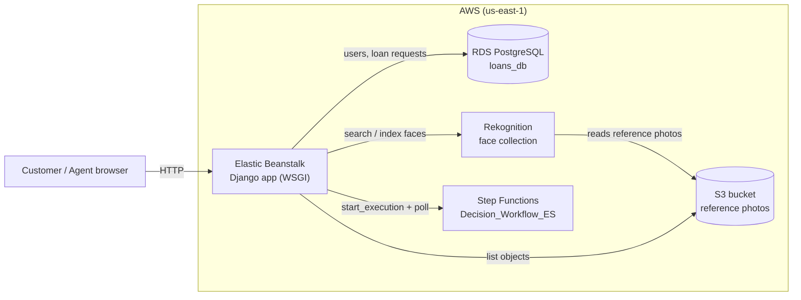

# Online Bank Loan Service — Engenharia de Serviços (MECD 2024/2025)

Practical project for the **Service Engineering** course (Universidade de Coimbra, FCTUC/DEI).
The goal was to model and implement the service of **requesting a bank loan online**:

1. The customer simulates a loan (amount, duration, monthly payment) on the bank's website.
2. To submit the request they must log in using **facial recognition**.
3. They fill in financial data (income, expenses); the system computes a decision and classifies the request as **accept**, **interview** or **reject**.
4. A loan officer (bank agent) logs in with username/password and manages requests from a dashboard, including scheduling interviews.

The project has two parts:

| Part | Content | Location |
|------|---------|----------|
| Part 1 — Service design | Personas, customer journey maps (happy path + exception), stakeholder map, expectation maps | [`docs/`](docs/) |
| Part 2 — Implementation | Django/DRF web application deployed on AWS | [`app/`](app/) |

### Service design deliverables

| Document | Files |
|----------|-------|
| [Personas](docs/personas/) | Mafalda Veloso, Maria Conceição, Pedro Coutinho |
| [Customer journey maps](docs/journey-maps/) | Happy path + exception scenario for each persona |
| [Expectation maps](docs/expectation-maps/) | One per persona |
| [Stakeholder map](docs/Stakeholder%20Map.pdf) | Including IT team, guarantor, government, client support |
| [Assignment brief](docs/assignment/) | Course statement for Part 1 |

The maps were revised after the first feedback round; the changes are listed in
[`docs/alteracoes-entrega-1.txt`](docs/alteracoes-entrega-1.txt).

---

## Architecture overview

The application is a Django + Django REST Framework backend that serves a plain HTML/JS frontend. Everything that is *not* the web app itself runs on AWS (region `us-east-1`):



---

## Where AWS is used

### 1. AWS Elastic Beanstalk — hosting the Django application

The whole backend is deployed as an Elastic Beanstalk Python application.

| What | Where |
|------|-------|
| EB CLI configuration: platform *Python 3.12 on 64bit Amazon Linux 2023*, region `us-east-1` | `app/.elasticbeanstalk/config.yml` (git-ignored — regenerated by `eb init`) |
| Tells EB which WSGI entry point to run (`Projeto.wsgi:application`) | [`app/.ebextensions/django.config`](app/.ebextensions/django.config) |
| Public EB hostname allowed by Django (`EB_HOSTNAME` environment variable) | [`app/Projeto/settings.py`](app/Projeto/settings.py) — `ALLOWED_HOSTS` |

Deployment is done with the EB CLI (`eb deploy`) from the `app/` directory. The EC2 instances behind the environment use their instance profile to call the other AWS services below (no keys are stored in the code).

### 2. Amazon RDS (PostgreSQL) — application database

Django's default database is a managed PostgreSQL instance on RDS, accessed with `psycopg2`.

| What | Where |
|------|-------|
| `DATABASES['default']` → engine `postgresql_psycopg2`; database, host, user and password read from the `RDS_*` environment variables | [`app/Projeto/settings.py`](app/Projeto/settings.py) |
| Tables stored there: `UserModel` (custom user with `face_id`, `phone_no`, `photo`) and `LoanRequest` (amounts, duration, installment, income, expenses, agent, status, interview date) | [`app/Projeto/quickstart/models.py`](app/Projeto/quickstart/models.py) |

The `face_id` column on `UserModel` is the link between the relational database and Rekognition: it stores the `FaceId` that Rekognition assigned to the customer's reference photo.

### 3. Amazon Rekognition — facial-recognition login

This is the core AWS feature of the project. Customers do not have a password; they authenticate by uploading a photo of their face.

| What | Where |
|------|-------|
| Module-level client `boto3.client('rekognition', region_name='us-east-1')` | [`views.py:31`](app/Projeto/quickstart/views.py#L31) |
| `list_collections` / `create_collection` — manage the face collection `collection-id` | [`views.py:55-70`](app/Projeto/quickstart/views.py#L55-L70) |
| `index_faces` — reads reference photos **from S3** and indexes them into the collection (`ExternalImageId` = file name) | [`views.py:72-87`](app/Projeto/quickstart/views.py#L72-L87) |
| `associate_face` — `associate_faces` API to bind a FaceId to a Rekognition UserId | [`views.py:114-120`](app/Projeto/quickstart/views.py#L114-L120) |
| **Customer login** (`login_view_user`): receives `username` + photo, calls `search_faces_by_image` with the raw image bytes, compares the returned `FaceId` with `UserModel.face_id`; on match, issues a DRF auth token | [`views.py:150-194`](app/Projeto/quickstart/views.py#L150-L194) |
| `search_faces_by_image` against an S3 object with `FaceMatchThreshold=70` (test endpoint) | [`views.py:277-298`](app/Projeto/quickstart/views.py#L277-L298) |
| Standalone CLI helper to create / delete / list Rekognition collections using the first profile in `~/.aws/credentials` | [`app/create_collection.py`](app/create_collection.py) |

Login flow in one line: **browser photo → Django → Rekognition `SearchFacesByImage` → FaceId compared with the one stored in RDS → session + token.**

### 4. Amazon S3 — storage for reference face photos

| What | Where |
|------|-------|
| The bucket (`AWS_S3_BUCKET`) holds the customers' reference photos that are indexed into the Rekognition collection via `S3Object` references | [`views.py:72-112`](app/Projeto/quickstart/views.py#L72-L112) |
| `photo_count` view — `s3.list_objects_v2` on the bucket, returns `KeyCount` (`GET /photo-count/`) | [`views.py:588-594`](app/Projeto/quickstart/views.py#L588-L594) |
| `django-storages` is listed as a dependency but is **not** configured in `settings.py`; S3 is only accessed directly through boto3 | [`app/requirements.txt`](app/requirements.txt) |

### 5. AWS Step Functions — loan decision workflow

The credit decision (accept / interview / reject) is not computed inside Django. It is delegated to a Step Functions state machine, which plays the role of the "credit-score module" described in the assignment.

| What | Where |
|------|-------|
| In `doc_cliente` (the *Documentos* page handler), after the customer submits income/expenses: `boto3.client('stepfunctions').start_execution(...)` on the state machine named by `DECISION_WORKFLOW_ARN`, with input `{"salary": income, "monthly_payment": installment}` | [`views.py:429-442`](app/Projeto/quickstart/views.py#L429-L442) |
| Polls `describe_execution` every 5 s until the execution reaches `SUCCEEDED` / `FAILED` / `TIMED_OUT` | [`views.py:470-478`](app/Projeto/quickstart/views.py#L470-L478) |
| The execution's `output.message` becomes the `status` of the new `LoanRequest` row saved to RDS | [`views.py:481-500`](app/Projeto/quickstart/views.py#L481-L500) |
| Explicit handling of `NoCredentialsError`, `PartialCredentialsError` and `ClientError` codes (`AccessDeniedException`, `InvalidArnException`, `StateMachineDoesNotExist`, `ExecutionAlreadyExists`) | [`views.py:444-466`](app/Projeto/quickstart/views.py#L444-L466) |

> The state machine definition itself lives in the AWS account (created in the console) and is **not** versioned in this repository — only its ARN is referenced from `views.py`.

### 6. Amazon DynamoDB — exploratory only

[`app/Projeto/dynamodb.py`](app/Projeto/dynamodb.py) is a standalone script that lists DynamoDB tables and reads one item (`ID_cliente`, `Name`, `Photo`) from a `Client` table. It was an early experiment for storing customer data; the final application uses RDS instead and this module is **not imported by the Django app**.

### 7. Credentials / IAM

No AWS keys are committed. `boto3` uses the default credential chain:

- **Locally:** `~/.aws/credentials` (`create_collection.py` and `views.list_collections` explicitly read the first profile from that file).
- **On Elastic Beanstalk:** the EC2 instance profile attached to the environment.

The `vockey` key pair in the EB config indicates the project ran in an **AWS Academy Learner Lab** account.

---

## Application flow

| Step | Page / endpoint | Backend | AWS involved |
|------|-----------------|---------|--------------|
| Loan simulator | `/` (`index.html`, `cookies-index.js`) | `index_view` — values saved in a `loanData` cookie | — |
| Customer login (face) | `/login/` (`login-cliente1.html`) | `login_view_user` | Rekognition, RDS |
| Financial data & decision | `/documentos.html` | `doc_cliente` | Step Functions, RDS |
| Customer dashboard | `/dashboard-cliente.html`, `/api/emprestimos/?face_id=` | `dashboard_client`, `get_emprestimos_by_client` | RDS |
| Agent login (password) | `/login-agent/` (`login-agente.html`) | `login_view_agent` | RDS |
| Agent dashboard | `/dashboard-agent.html`, `/loan-requests/`, `/update-interview/<id>/` | `dashboard_agent`, `get_all_loan_requests`, `update_interview_date` | RDS |
| Admin / utility | `/index-faces/`, `/search-faces/`, `/photo-count/`, `/view-users/`, `/admin/` | see `views.py` | Rekognition, S3, RDS |

Routes are defined in [`app/Projeto/urls.py`](app/Projeto/urls.py).

---

## Project structure

```
Projeto_final/
├── README.md
├── LICENSE
├── .gitignore
├── docs/                              # Part 1: service design deliverables
│   ├── assignment/                    # Course statement
│   ├── personas/                      # 3 personas
│   ├── journey-maps/                  # Happy path + exception, per persona
│   ├── expectation-maps/              # One per persona
│   ├── Stakeholder Map.pdf
│   └── alteracoes-entrega-1.txt       # Changes made after the feedback round
└── app/                               # Part 2: Django application
    ├── .env.example                   # Template for the required environment variables
    ├── .ebextensions/django.config    # Elastic Beanstalk WSGI setting
    ├── create_collection.py           # CLI helper for Rekognition collections
    ├── manage.py
    ├── requirements.txt               # Django, DRF, boto3, psycopg2, django-storages, ...
    └── Projeto/
        ├── settings.py                # RDS connection, EB host, DRF config
        ├── urls.py                    # All routes
        ├── dynamodb.py                # DynamoDB experiment (unused by the app)
        └── quickstart/
            ├── models.py              # UserModel (face_id), LoanRequest
            ├── views.py               # Rekognition / S3 / Step Functions integration
            ├── serializers.py
            ├── static/                # Frontend JS (simulator, login, dashboards)
            └── templates/frontend/    # HTML pages
```

`app/staticfiles/` (the `collectstatic` output) and `app/db.sqlite3` are generated
and therefore git-ignored; run `python manage.py collectstatic` to rebuild the first.

---

## Configuration

No AWS account id, bucket name, database password or secret key is stored in the
source. All of them are read from environment variables — copy
[`app/.env.example`](app/.env.example) to `.env` and fill it in:

| Variable | Used for |
|----------|----------|
| `DJANGO_SECRET_KEY` | Django signing key |
| `EB_HOSTNAME` | Elastic Beanstalk environment URL added to `ALLOWED_HOSTS` |
| `RDS_DB_NAME`, `RDS_USERNAME`, `RDS_PASSWORD`, `RDS_HOSTNAME`, `RDS_PORT` | RDS PostgreSQL connection (Elastic Beanstalk sets these automatically when an RDS instance is attached to the environment) |
| `AWS_S3_BUCKET` | Bucket holding the reference face photos |
| `REKOGNITION_COLLECTION_ID` | Rekognition face collection (default `collection-id`) |
| `DECISION_WORKFLOW_ARN` | ARN of the `Decision_Workflow_ES` state machine — **contains the AWS account id** |

On Elastic Beanstalk, set them under **Configuration → Software → Environment properties**
rather than in a file. `.env` is listed in `.gitignore`.

## Running locally

Prerequisites: Python 3.12, an AWS profile in `~/.aws/credentials` with access to Rekognition, S3, Step Functions and the RDS instance (region `us-east-1`).

```bash
cd app
cp .env.example .env        # then fill in your own values
python -m venv .venv && source .venv/bin/activate     # Windows: .venv\Scripts\activate
pip install -r requirements.txt
set -a && . ./.env && set +a                          # export the variables
python manage.py migrate
python manage.py runserver
```

`settings.py` points at the RDS instance by default; to run fully offline switch `DATABASES` to the bundled `db.sqlite3`. Rekognition/S3/Step Functions calls still require AWS access.

## Deploying to Elastic Beanstalk

```bash
cd app
eb init      # choose Python 3.12 on Amazon Linux 2023, region us-east-1
eb deploy django-env
```

---

## Known limitations

- `DEBUG = True` and `ALLOWED_HOSTS = ['*']` are set for the academic deployment.
- The Step Functions execution is polled synchronously inside the request; a long-running workflow would block the web worker.
- Notifications to the customer (SMS/e-mail, e.g. via Amazon SNS/SES) described in the assignment were not implemented.
